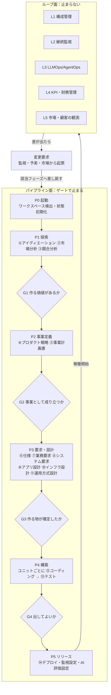
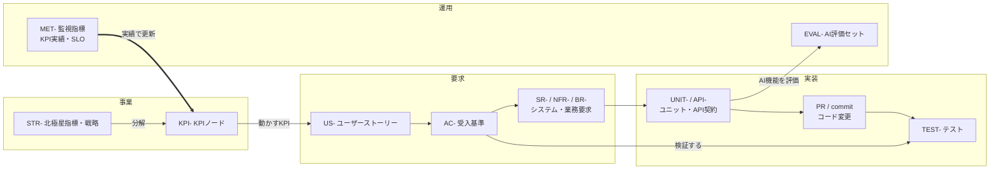
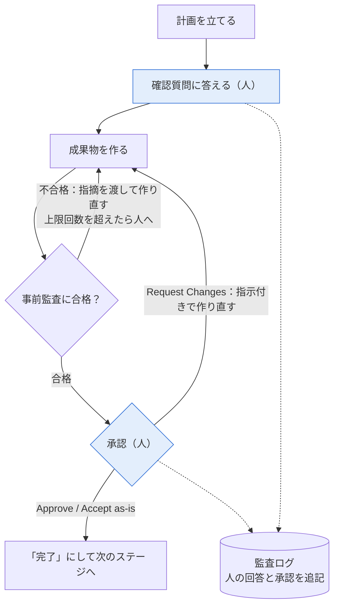
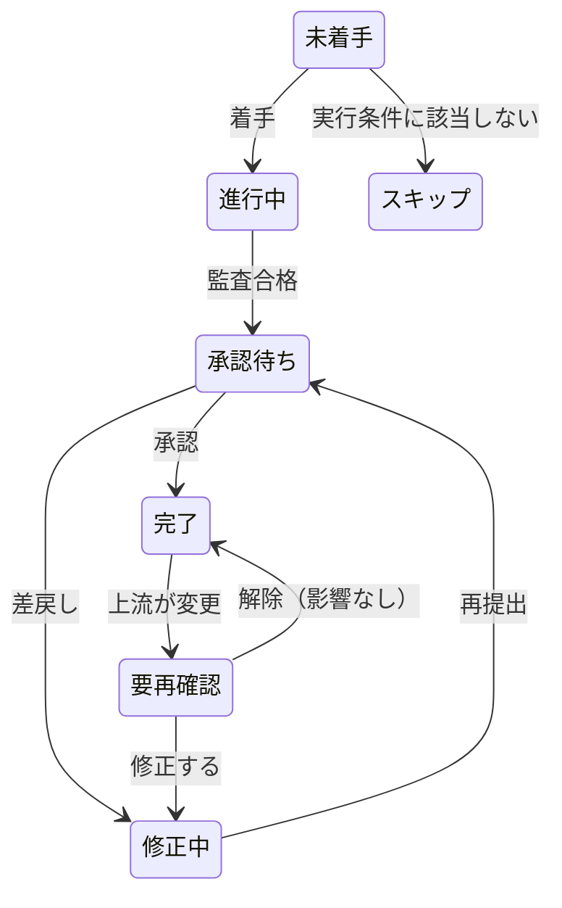
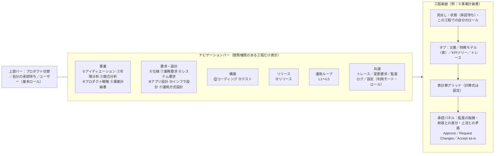
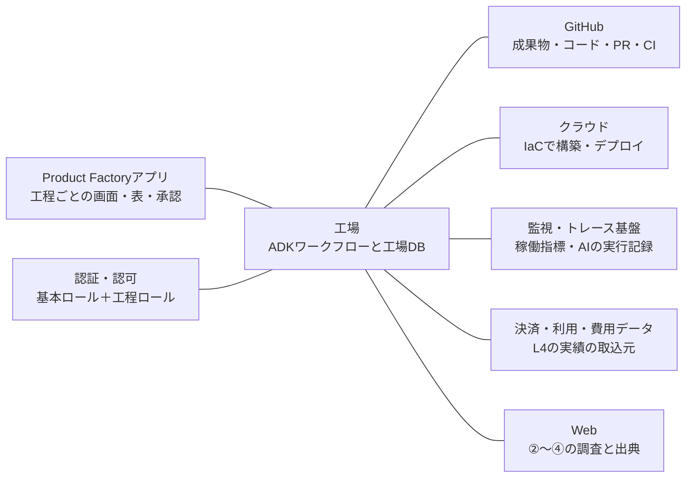
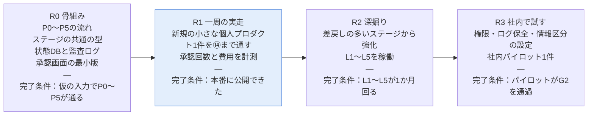

# Product Factory 設計書（AI-DLC拡張 × Google ADK）

Oct 24, 2026

## 0. 本書の位置づけ

一人のプロダクトビルダーが、アイデアから運用までの17工程を一つの基盤で実行する「Product Factory（以下、工場）」の設計を定める。

| 項目 | 決定内容 |
| --- | --- |
| 目的 | 17工程を一人で、承認ゲート付きで、成果物を連結したまま実行する |
| 実行基盤 | Google ADK 2.0（Python v2.0.0、2026-05-19 GA） |
| 利用者 | 段階1：個人プロダクトで検証 → 段階2：組織内のプロダクトビルダーへ展開 |
| 初期範囲 | 全工程を薄く一周する。各工程は最小の成果物とゲートだけを持つ |
| 本書の対象 | 工場そのものの設計。工場が作るプロダクトの設計は対象外 |
| 方法論の参照元 | AWS Labs「AI-DLC」（[awslabs/aidlc-workflows](https://awslabs.github.io/aidlc-workflows/)） |

**本書の用語**

| 用語 | 意味 |
| --- | --- |
| フェーズ | 工程のまとまり。境界でフェーズ審査（G1〜G4）を行う（P0〜P5） |
| ステージ | 1つの成果物を作る単位（①〜⑭） |
| ゲート | 人が承認するまで次へ進めない停止点 |
| ループ | ゲートを持たず常時回る業務（L1〜L5） |
| 成果物 | ステージが出力するファイル。IDを持ち、上流の成果物を参照する |
| ユニット | 構築フェーズで並行・反復実装する機能の単位 |

## 1. AI-DLCとの対応と差分

現行のAI-DLCは17工程のうち4工程（競合分析・プロダクト戦略・事業計画書・財務管理）を持たず、継続業務である監視とLLMOpsは「設定して終わる」形でしか扱わない。

今回構築するのは、事業を計画・実装し、継続運用することを、事業観点・システム観点両面において実現するものであり、これを「Product Factory」と呼称する。

Product Factoryを操作するのはProduct Builderである。Product BuilderはProduct Managerの役割を拡張させた職種であり、事業やプロダクトの戦略を考えるところから、そのプロダクトの実装までをすべて実行する役割を担う。

添付画像はInception 6ステージ版だが、現行版は Initialization（3）・Ideation（7）・Inception（9）・Construction（7）・Operation（7）の5フェーズ33ステージに拡張されている（[公式図](https://awslabs.github.io/aidlc-workflows/reference/diagrams/)）。本書は現行版を基準にする。

### 1.1 17工程とAI-DLCステージの対応

| # | 工程 | AI-DLCの対応ステージ | 対応 |
| --- | --- | --- | --- |
| 1 | アイディエーション | 1.1 Intent Capture & Framing、1.4 Scope Definition、1.6 Rough Mockups | あり |
| 2 | 市場分析 | 1.2 Market Research（条件付き） | あり |
| 3 | 競合分析 | 専用ステージなし（1.2に含める前提と推定） | なし |
| 4 | プロダクト戦略 | なし（1.3 Feasibility & Constraintsは実現可否の確認） | なし |
| 5 | 事業計画書 | なし | なし |
| 6 | KPI/PL/BS/CS管理 | なし | なし |
| 7 | プロダクト仕様 | 2.3 Requirements Analysis、2.4 User Stories、2.5 Refined Mockups | あり |
| 8 | 業務要求定義 | 2.6 Domain Design（業務フロー・業務ルールの専用ステージはない） | 一部 |
| 9 | システム要求定義 | 2.3 Requirements Analysis、3.2 NFR Requirements | あり |
| 10 | アプリケーション設計 | 2.6 Domain Design、2.7 Units Generation、2.8 Contract Design、3.1 Functional Design | あり |
| 11 | インフラ設計 | 3.4 Infrastructure Design、4.2 Environment Provisioning | あり |
| 12 | 運用方式設計（CI/CD） | 3.7 CI Pipeline、4.1 Deployment Pipeline、4.5 Incident Response | あり |
| 13 | ソフトウェア構成管理 | 専用ステージなし | なし |
| 14 | コーディング | 3.5 Code Generation | あり |
| 15 | テスト | 3.6 Build and Test、4.6 Performance Validation | あり |
| 16 | システムの継続的監視 | 4.4 Observability Setup、4.7 Feedback & Optimization（設定まで） | 一部 |
| 17 | LLMOps/AgentOps | なし | なし |

### 1.2 そのまま使うものと、足すもの

| AI-DLCの仕組み | 本設計での扱い |
| --- | --- |
| 各ステージ末の承認（Approve / Request Changes / Accept as-is） | そのまま使う。加えてフェーズ境界に審査（G1〜G4）を置く（3章） |
| ALWAYS / CONDITIONAL のステージ選択とスコープ（mvp / poc） | そのまま使う。事業側ステージにも同じ判定を足す |
| 状態ファイル（未着手 / 進行中 / 承認待ち / 修正中 / 完了 / スキップ） | そのまま使う。ADKのセッション状態に持ち、ファイルにも書き出す |
| 監査ログ（発言をそのまま、追記のみ） | そのまま使う。承認者・承認対象の版・理由を必須項目にする |
| ユニットごとの構築ループ | そのまま使う |
| ルールファイルをコーディングエージェント（Claude Code、Kiro等）が読んで実行 | 置き換える。工程の順序とゲートをADKのグラフでコードにする |
| — | 足す：事業ステージ（競合分析・戦略・事業計画・財務モデル） |
| — | 足す：常時回る5ループ（構成管理・監視・LLMOps/AgentOps・KPIと財務の予実管理・市場と顧客の観測） |
| — | 足す：事業計画のKPIからコード・監視指標までをIDでつなぐトレース |

### 1.3 設計を決める2つの指摘

**① 17工程に「一度やって終わる工程」はない。違いは、きっかけを待って再実行するか、常に回り続けるか。** 事業側の①〜⑤は市場・競合・顧客の変化と予実の差をきっかけに、開発側の⑥〜⑭は変更要求をきっかけに、何度もやり直す。一方、構成管理・継続監視・LLMOps/AgentOps・KPIと財務の予実管理・市場と顧客の観測は、きっかけを待たずに動き続ける。AI-DLCは4.7で終わる一方向の流れなので、後者をステージとして並べると「承認したら終わり」になり、運用が止まる。工場は「ゲートで止まり、きっかけがあれば再び入るパイプライン」と「止まらないループ」の2面で作り、ループの結果を再実行のきっかけにする（2章）。

**② 一人で回すときの上限は、AIの作業量ではなくビルダーの承認回数で決まる。** 全ステージを承認制にすると、一周で「13ステージ＋ユニット数」回とフェーズ審査4回の承認が発生し、修正が入ればその数倍になる。本設計は全ステージ承認を採り、承認1回あたりの時間を縮める。承認画面には「監査エージェントの指摘」「前の版との差分」「上流の成果物との矛盾」を先に出し、全文は必要なときだけ開く（3章、6章）。

## 2. 全体アーキテクチャ

工場は、ゲートで止まるパイプライン面（P0〜P5）と、リリース後も回り続けるループ面（L1〜L5）の2面で作る。両面は共通基盤の成果物・トレース・監査ログを共有する。

**図：工場の全体構成 · 6フェーズ、4ゲート、5ループ**

ループで障害や予実差が出ると変更要求を起票し、パイプラインの該当フェーズへ戻す。戻った先からはもう一度ゲートを通る。

## 3. ステージとループの定義

17工程を、ゲートで止まる14ステージ（①〜⑭）と常時回る5ループ（L1〜L5）に割り当てる。⑭リリースは17工程にないが、パイプラインからループへの受け渡し点として追加した。

### 3.1 ゲートの種類

| 種類 | 誰が判定するか | 止まるか | 置く場所 |
| --- | --- | --- | --- |
| 自動判定 | テスト・静的解析・スキーマ検証などの決定的チェック | 失敗したら止まる | ⑫⑬の各ユニット内 |
| 事前監査 | 監査エージェント（上流との矛盾、受入基準の漏れ、必須項目の欠落） | 不合格なら承認依頼を出さず作り直す | 各ステージ承認の前 |
| ステージ承認 | ビルダー | 承認まで止まる | ①〜⑭の各ステージ末（⑫はユニットごと） |
| フェーズ審査 | ビルダー（社内展開時は承認者も） | 承認まで止まる | フェーズ境界 G1〜G4 |

ステージ承認の応答は AI-DLC と同じ Approve / Request Changes / Accept as-is の3つ。フェーズ審査は「進む / 戻る / やめる」の3つで、「やめる」は撤退条件（④）に照らして判断する。

本番デプロイ、課金が発生する操作、外部への公開は、段階に関係なく実行直前にビルダーの確認を取る（ADKの Tool Confirmation）。

### 3.2 14ステージ

| ステージ | 主な成果物 | 主な入力 | 実行条件 | ゲート |
| --- | --- | --- | --- | --- |
| ① アイディエーション | idea-brief（課題・対象顧客・解決仮説・初期スコープ）、ラフ画面 | ビルダーの意図 | 常に | 承認 |
| ② 市場分析 | market（市場規模の推計式と出典、顧客セグメント） | ① | pocでは省略可 | 承認 |
| ③ 競合分析 | competitors（競合・代替手段の一覧、比較軸、位置づけ） | ①② | pocでは省略可 | 承認 → **G1** |
| ④ プロダクト戦略 | strategy（狙う顧客、価値提案、差別化、北極星指標、撤退条件） | ①〜③ | 常に | 承認 |
| ⑤ 事業計画書 | business-plan、財務モデル（KPIツリー、収益モデル、PL/BS/CS計画、投資額） | ②〜④ | pocではKPIツリーのみ | 承認 → **G2** |
| ⑥ プロダクト仕様 | product-spec（ペルソナ、ユーザーストーリー、受入基準、画面モック） | ④⑤ | 常に | 承認 |
| ⑦ 業務要求定義 | business-req（to-be業務フロー、業務ルール、役割、問合せ・決済・審査など人が行う業務） | ⑥ | 人が行う業務がある場合 | 承認 |
| ⑧ システム要求定義 | system-req（機能要求、性能・可用性・セキュリティ・コスト上限、外部接続） | ⑥⑦ | 常に | 承認 |
| ⑨ アプリケーション設計 | app-design（コンポーネント、ドメインモデル、API契約、ユニット分割） | ⑧ | 常に | 承認 |
| ⑩ インフラ設計 | infra-design（構成、環境、IaC方針、月額コスト見積） | ⑧⑨ | クラウドに配置する場合 | 承認 |
| ⑪ 運用方式設計 | ops-design（CI/CD、監視項目、SLO、障害対応、AI機能の評価方式） | ⑧〜⑩ | 常に | 承認 → **G3** |
| ⑫ コーディング | ユニットごとのプルリクエスト | ⑨〜⑪ | ユニットごとに反復 | 自動判定 → ユニットごとに承認 |
| ⑬ テスト | 結合・受入テスト結果、受入基準の網羅表 | ⑥⑫ | 全ユニットの統合後 | 自動判定 → 承認 → **G4** |
| ⑭ リリース | デプロイ記録、監視設定、AI評価設定 | ⑪⑬ | 常に | 承認＋実行直前の確認 |

| 必須ゲート | ビルダーが答える問い | 判断材料 |
| --- | --- | --- |
| G1 | 作る価値があるか | ①〜③と、監査エージェントの反論メモ |
| G2 | 事業として成り立つか | ④⑤、撤退条件、財務モデルの感度分析 |
| G3 | 作る物が確定したか | ⑥〜⑪、受入基準から設計へのトレース率 |
| G4 | 出してよいか | ⑬の結果、未解決の欠陥、リリース後の月額コスト見込み |

### 3.3 5ループと再実行

| ループ | 何をするか | 回す周期 | 差し戻し先 |
| --- | --- | --- | --- |
| L1 ソフトウェア構成管理 | 成果物とコードをGitで版管理し、承認した版にタグを付ける。リリースノートを作る | 成果物が確定するたび | — |
| L2 継続監視 | 稼働指標・エラー・クラウド費を監視し、SLO違反で障害チケットを起票する | 常時＋日次サマリ | ⑫（不具合）、⑨⑩（設計起因） |
| L3 LLMOps/AgentOps | プロダクト内AI機能の評価セット、プロンプトとモデルの版、トレース、回帰評価、推論コストを管理する | リリースごと＋週次 | ⑫（品質低下）、⑧（要求の見直し） |
| L4 KPI・財務管理 | 利用・売上・費用の実績を取り込み、KPIツリーとPL/BS/CSの予実差を出す | KPIは週次、財務は月次 | ④⑤（戦略・計画の見直し）、⑥（機能の優先度） |
| L5 市場・競合・顧客の観測 | 市場の統計、競合の新機能・価格・資金調達、顧客の声（問合せ・レビュー・解約理由）を集め、②③⑤に書いた「見直し条件」に当たるかを判定する | 週次＋大きな変化は即時 | ②③（分析の更新）→④⑤（戦略・計画の見直し）、①（新しい機能・事業のアイデア） |

**事業フェーズの再実行**

| きっかけ | 再実行するステージ | 通し直す審査 |
| --- | --- | --- |
| L5が「見直し条件」に当たる変化を検知（例：競合が同じ機能を無料で出した） | ②③ → ④⑤ | G1、G2 |
| L4の予実差が⑤で決めた許容幅を超えた | ④⑤ | G2 |
| 定期見直し（四半期ごとを案とし、R2で決める） | ②〜⑤ | G1、G2 |
| ビルダーが新しい機能・事業のアイデアを出した | ①から | G1以降すべて |

②③⑤の成果物には「この前提が崩れたら見直す」条件を必須項目として書き、L5とL4がその条件を見張る。再実行で前提が変われば、下流の⑥以降は4.3の仕組みで「要再確認」になる。

L4の財務の持ち方は、工場の設定「利用モード」で個人と法人を切り替える。BSとCSは会社単位の財務諸表なので、モードによって作る表が変わる。

| 設定項目 | 個人モード | 法人モード |
| --- | --- | --- |
| 財務の単位 | 個人事業、または個人が作る法人 | 会社の中の1プロダクト |
| 作る表 | PL・BS・CSを連動させる | PLと投資キャッシュフロー。プロダクト単位のBSは作らない |
| 実績の取込元 | 決済サービス、クラウドの請求、手入力 | 管理会計のデータ、社内の費用配賦 |
| 予実の比較先 | ⑤の計画 | ⑤の計画と社内の予算 |
| 会計の区切り | 自分で決める決算期 | 会社の会計年度 |

法人モードの表の構成は、その会社の管理会計の定義に合わせる（12章で確認）。

①〜⑭の各ステージは AI-DLC と同じく「計画 → 確認質問 → 成果物」の順で進む。確認質問は選択式で出し、答えと矛盾する過去の回答があれば先に指摘する。

## 4. 成果物モデルとトレーサビリティ

全成果物の要素に「種別-連番」のIDを振り、上流のIDを参照させる。これで事業のKPIからコード・テスト・監視指標までを一本でたどれるようにする。

**図：トレースの連鎖 · 4層、10種のID**

監視指標の実績はKPIノードへ戻り、L4の予実管理に使われる。この戻りがないと、事業計画と運用が別々の数字を見る。

### 4.1 正本の置き場所

| 成果物の種類 | 正本 | Gitへの記録 |
| --- | --- | --- |
| 文書（①〜④、⑥〜⑪） | Git上のMarkdown。IDと参照先は先頭のYAMLに書く | そのもの |
| 表（⑤の財務モデル・KPIツリー、L4の予実） | 工場アプリ内の表（表計算エンジン） | 承認時にCSV/JSONの写しとハッシュを保存 |
| コード・IaC・CI定義 | Git | そのもの |
| 監視・AI評価の実績 | 監視基盤・トレース基盤 | 日次サマリのみ |

承認は「どの版を承認したか」を残す必要があるので、表データも承認時点の写しをGitに固定する。

### 4.2 参照の種類

| 上流 → 下流 | 意味 | 参照を作るステージ |
| --- | --- | --- |
| STR → KPI | 北極星指標をKPIツリーに分解する | ⑤ |
| KPI → US | そのストーリーがどのKPIを動かすか | ⑥ |
| US → AC | ストーリーの完了条件 | ⑥ |
| AC → SR / NFR / BR | 受入基準を満たすためのシステム要求・業務ルール | ⑦⑧ |
| SR → UNIT / API | 要求を実現するユニットとAPI | ⑨ |
| UNIT → PR | ユニットを実装したコード変更 | ⑫ |
| AC → TEST | 受入基準を確かめるテスト | ⑬ |
| NFR / KPI → MET | SLOとKPIを測る監視指標 | ⑪ |
| UNIT → EVAL | AI機能を持つユニットの評価セット | ⑪⑫ |

### 4.3 変更の伝わり方

1. 上流の要素が承認後に変わると、参照している下流の要素をすべて「要再確認」にする。
2. 要再確認が残っているステージは、承認済みでも「修正中」に戻る。
3. 監査エージェントは影響範囲の一覧を作り、ビルダーは「修正する / 影響なしとして解除する」を要素ごとに選ぶ。
4. IDは削除しても再利用しない。廃止した要素は「廃止」として残す。

## 5. エージェント構成（ADK）

工程の順序とゲートは ADK 2.0 のグラフワークフローでコードとして固定し、LLMには各ステージの中身だけを任せる。次にどこへ進むかをLLMに判断させない。

### 5.1 4つの層

| 層 | 中身 | ADKでの実装 |
| --- | --- | --- |
| 工程管理 | P0〜P5と①〜⑭の順序、ゲートの分岐、差し戻し | グラフワークフロー。ステージごとに下の「共通の型」を入れ子にする |
| ステージ | ①〜⑭をそれぞれ担当する14のエージェント | LLMエージェント。指示文、成果物の型、使えるツール、モデルをステージごとに定義する |
| 共通役 | 監査（矛盾・漏れ・トレース）、調査（Web検索と出典管理）、財務計算（表計算エンジンの操作） | 複数ステージから呼ぶサブエージェント |
| ループ | L1〜L5 | L1はGitのイベント、L2〜L5は定期実行で起動する別ワークフロー |

### 5.2 ステージの共通の型

**図：ステージの共通の型 · 人の入力は2点**

人の入力は ADK の RequestInput（ノードが入力要求を出し、回答までワークフローを止める仕組み）で実装する。確認質問と承認は回答の形を response\_schema で定め、専用画面がその形からフォームを作る（[ADK: Human input](https://adk.dev/graphs/human-input/)）。本番デプロイなど実行直前の確認は、ツール単位の Tool Confirmation を使う。

### 5.3 コード生成の切替

⑫コーディングは、入力と出力をそろえた2つの実行方式を切り替えられる部品にする。

| 項目 | A. 外部コーディングエージェントに委任 | B. ADKエージェントが自前で書く |
| --- | --- | --- |
| 実行者 | Claude Code、Gemini CLI などをサンドボックス内で対話なしに起動 | ファイル編集・コマンド実行ツールを持つADKのLLMエージェント |
| 入力（共通） | ユニット定義、関係するAC・SR・API契約、リポジトリ、コーディング規約 | 同左 |
| 出力（共通） | プルリクエスト、単体テスト結果、変更したIDの一覧 | 同左 |
| 向いている場面 | 既存コードが大きい、変更が複数ファイルにまたがる | 小さいユニット、生成パターンが決まっているコード |
| 弱点 | 外部ツールの仕様変更と利用料金に依存する。内部の判断過程が見えにくい | コード生成の仕組み（文脈の集め方、編集、再試行）を自分で作り、保守する |

切替はプロダクト単位の設定で決め、ユニット単位で上書きできるようにする。どちらで書いても、⑬と承認は同じ基準で通す。

### 5.4 ツール接続

| 接続先 | 使うステージ | 接続方法 |
| --- | --- | --- |
| Web検索・ページ取得 | ②③④ | ADKのツール |
| 表計算エンジン（アプリ内） | ⑤、L4 | アプリ内のAPIをツールとして呼ぶ。呼び出しは指示したユーザーの権限で通す（10.1） |
| GitHub（リポジトリ、PR、Actions） | ⑫⑬⑭、L1 | MCPサーバー |
| クラウド（構築・デプロイ） | ⑩⑭ | IaCツールをサンドボックスで実行。本番反映は Tool Confirmation 必須 |
| 監視・トレース基盤 | L2、L3 | 参照用のAPIツール |

## 6. 状態管理と監査ログ

工程の状態の正本は工場のDBに置き、ADKのセッションは1ステージの実行ごとに使う。1つのセッションに14ステージ分の会話を積むと、履歴が肥大して文脈に収まらなくなるため。

### 6.1 何をどこに置くか

| 保存するもの | 置き場所 | ADKの部品 |
| --- | --- | --- |
| ステージの状態、承認された版 | 工場DB（正本）、Gitの状態ファイル（写し） | — |
| 実行中の会話、中間結果、停止中の入力要求 | 永続化したセッションストア | SessionService |
| 成果物ファイル | Git（文書・コード）、オブジェクトストレージ（画像・大きいファイル） | ArtifactService |
| ビルダーの過去の判断、好み、振り返り | 長期記憶 | MemoryService |
| 監査ログ | 追記専用ストレージ | 全イベントをコールバックで書き出す |

### 6.2 ステージの状態

**図：ステージの状態遷移 · 7状態**

「要再確認」は4.3の変更伝播で付く。要再確認のステージが残っている間は、そのフェーズの審査（G1〜G4）を開けない。

### 6.3 監査ログの項目

| 項目 | 内容 |
| --- | --- |
| 日時・プロダクト・ステージ | いつ、どの工程で起きたか |
| 実行者 | 人（ユーザーID）かエージェント（名前・モデル・指示文の版） |
| 種類 | 確認質問、回答、承認、差戻し、Accept as-is、実行直前の確認、状態変更 |
| 対象の版 | 成果物IDとGitのコミット（表は写しのハッシュ） |
| 本文 | 人の回答・コメントは要約せずそのまま残す |
| 理由 | Accept as-is と差戻しでは必須 |

個人検証ではGit上の追記ファイルで足りる。社内展開では書き換えできないストレージ（保持ロック付き）に移す（10章）。

## 7. 画面と外部連携

利用者が触る画面は1つのWebアプリにまとめる。工程ごとに画面を分け、左のナビゲーションバーで切り替える。

**図：画面構成 · 工程ごとの画面とナビゲーションバー**

**図：外部連携の全体 · アプリ1つ、外部サービス5つ**

### 7.1 画面の一覧

| ナビの区分 | 画面 | 画面内のタブ |
| --- | --- | --- |
| 事業 | ①〜⑤を工程ごとに1画面 | 文書、表（⑤は財務モデル・KPIツリー）、トレース、承認 |
| 要求・設計 | ⑥〜⑪を工程ごとに1画面 | 文書、図（業務フロー・構成図）、トレース、承認 |
| 構築 | ⑫⑬ | ユニット一覧、プルリクエスト、テスト結果、承認 |
| リリース | ⑭ | デプロイ記録、実行直前の確認 |
| 運用ループ | L1〜L5をループごとに1画面 | 状況、検知した差、起票した変更要求（L4は予実の表） |
| 共通 | トレース、変更要求、監査ログ、設定 | 設定で利用モードとロールを管理 |

画面上部には、プロダクトの切替と「自分の承認待ち」を常に出す。分業しているときは、各自がここから自分の担当工程へ移る。

### 7.2 表計算の仕組み

| 仕組み | 工場での使い方 |
| --- | --- |
| 表計算エンジン | 財務3表とKPIツリーを計算する。計算式はテンプレートとして固定し、LLMに計算させない |
| 表UI（グリッド） | ⑤とL4の表の画面に使う。他の工程でも表が合う成果物（⑦の業務ルール一覧など）に使える |
| エージェントと表の分担 | エージェントは前提値の案と根拠（②③の出典）を書き込み、シナリオを複製して感度分析を作る。利用者が前提値を直すと、参照している⑥以降は要再確認になる |
| 承認の対象 | 承認時点の表の写し（CSV/JSON）とハッシュ。写しはGitに固定する（4.1） |

### 7.3 L4の実績データ

| 実績 | 取込元 | 反映先 |
| --- | --- | --- |
| 利用指標（利用者数、継続率など） | プロダクトの分析基盤 | KPIツリー |
| 売上 | 決済サービス | PL、CS |
| クラウド費・AI推論費 | クラウドの請求データ、L3の推論コスト | PL（原価） |
| その他の費用・資産・負債 | ビルダーの手入力（個人検証）、管理会計のデータ（社内展開） | PL、BS、CS |

## 8. 品質ガード

品質は「成果物」「工場のエージェント」「生成したプロダクト」の3つを分けて守る。決定的に判定できるものはLLMに判定させない。

### 8.1 成果物の事前監査

| チェック | 判定方法 | 対象 |
| --- | --- | --- |
| 必須項目の欠落 | スキーマ検証（決定的） | 全成果物 |
| 参照の漏れ | トレース検査（決定的）。どのKPIも動かさないストーリー、ACのないストーリー、テストのないAC、実装のないユニットを検出 | ⑤〜⑬ |
| 数値の出典 | 数値に出典URLがあるか（決定的）、出典ページにその数値があるか（LLM） | ②③⑤ |
| 財務の整合 | 貸借の一致、現金残高の連続、PLとCSのつながり（表計算で決定的） | ⑤、L4 |
| 上流との矛盾 | 別モデルのLLMが上流の承認済み成果物と照合する | 全成果物 |
| 反論 | 別モデルのLLMが「この事業が失敗する理由」を作り、G1・G2の判断材料に添える | ①〜⑤ |

監査には成果物を作ったモデルと別のモデルを使う。同じモデルだと、自分の出力の前提をそのまま受け入れやすいため。

### 8.2 工場のエージェントの評価

| 項目 | 内容 |
| --- | --- |
| 評価ケース | ステージごとに「入力と、成果物が満たすべき条件」の組を用意する。初期は過去に作った小さなプロダクトを題材にする |
| 実行 | ADKの評価機能（adk eval）で、指示文・モデル・ツールを変えるたびに全ケースを再実行する |
| 合格条件 | 既存ケースで事前監査の合格率が下がらないこと |
| 実運用での指標 | ステージごとの差戻し率、承認までの往復回数、ビルダーが手で直した分量、費用（9章） |

### 8.3 生成したプロダクトのテスト（⑫⑬）

| 種類 | いつ | 合格の基準 |
| --- | --- | --- |
| 静的解析・型チェック・依存ライブラリの脆弱性検査 | ⑫の各プルリクエスト | エラー0件 |
| 単体テスト | ⑫の各プルリクエスト | 全件成功 |
| 結合テスト（API契約どおりか） | ⑬ | 全件成功 |
| 受入テスト（ACごと） | ⑬ | 全ACにテストがあり、全件成功 |
| 性能テスト | ⑬（NFRに性能要件がある場合） | NFRの数値を満たす |
| AI機能の評価（EVAL） | ⑬ | ⑪で決めた合格線を満たす |

## 9. LLMOps/AgentOps

LLMOps/AgentOps は「工場自身のエージェント」と「工場が作ったプロダクトのAI機能」の2つに同じ仕組みを当てる。工場をL3の最初の利用者にすることで、L3を実運用で磨いてからプロダクトに使う。

| 項目 | 工場自身 | 工場が作ったプロダクト |
| --- | --- | --- |
| 評価セット | ステージごとの評価ケース（8.2） | AI機能ごとのEVAL（⑪で定義） |
| 指示文・モデルの版 | Gitで管理し、使った版を監査ログに記録 | 同じ |
| 実行記録 | ADKのイベントを OpenTelemetry 形式でトレース基盤へ送る | 同じ形式で送る |
| 運用中に見る指標 | 差戻し率、承認までの往復回数、ビルダーの手直し量 | 利用者の評価、失敗率、安全対策の発動数 |
| 費用 | ステージ別のトークン費用 | 機能別の推論費用。L4でPLの原価に入れる |
| モデル更新時 | 評価セットを再実行し、合格したら切り替える | 同じ。切替は⑭と同じく実行直前の確認を取る |
| 品質低下を検知したら | 該当ステージの指示文を改訂する変更要求を起票 | ⑫（実装）か⑧（要求）へ変更要求を起票 |

推論費用をL4の原価につなぐのは、AI機能を持つプロダクトでは利用が増えるほど推論費が増え、粗利が事業計画からずれやすいため。

## 10. セキュリティとガバナンス

個人検証と社内展開で工場の仕組みは変えず、設定と実行環境だけを切り替える。社内展開で加わるのは、役割の分離、機密情報の扱い、監査ログの改ざん防止の3つ。

| 項目 | 個人検証 | 社内展開 |
| --- | --- | --- |
| 実行環境 | 個人のクラウド環境 | 社内で利用承認されたクラウド環境 |
| 利用者と役割 | 本人のみ（全ロールを持つ） | 社内ID連携。基本ロールと工程ロールで分業する（10.1） |
| フェーズ審査の承認者 | 本人 | ビルダー＋事業側の承認者（特にG2） |
| LLMに渡す情報 | 公開情報と自分のデータ | 情報の取扱区分ごとに、渡してよいモデルと契約を設定で制限する |
| コードの実行 | サンドボックス | サンドボックス＋通信先の制限。認証情報はシークレット管理から渡し、成果物に書かない |
| 外部コーディングエージェント | 個人の契約 | 社内で利用承認された製品とアカウントのみ。未承認なら方式B（ADK自前）に限定 |
| 本番への操作 | 実行直前の確認 | 実行直前の確認＋本番用の権限を持つ人に限定 |
| 監査ログ | Git上の追記ファイル | 保持ロック付きストレージ。保存期間は社内規程に合わせる |

### 10.1 認証と認可

認証認可は Auth.js による一般的なマルチテナント方式にし、基本ロールの上に「工程ロール」を重ねて工程ごとに分業できるようにする。

| 層 | 決めること | 決め方 |
| --- | --- | --- |
| テナント | どの組織のデータを扱うか | ログイン中のセッションからだけ決める。リクエストに含まれるテナントIDは使わない |
| 基本ロール | テナント全体でできることの上限 | OWNER＞ADMIN＞MEMBER＞VIEWER の4段階（下の表）。別に運営者ロール PLATFORM_ADMIN を持つ |
| 工程ロール | プロダクトごと・工程グループごとに、閲覧・作成・承認のどれができるか | プロダクトの工程オーナーが割り当てる。基本ロールの上限は超えられない |

**基本ロールと工程ロールの関係**

| 基本ロール（プロダクト所属） | 持てる工程ロール | そのほかにできること |
| --- | --- | --- |
| VIEWER | 閲覧者 | — |
| MEMBER | 閲覧者・担当者・承認者 | — |
| ADMIN | すべて（工程オーナーを含む） | プロダクトのメンバー管理、工程ロールの割当 |
| OWNER | すべて | ADMINの権限＋テナント設定（利用モード、LLM設定、契約プラン） |

テナントの ADMIN 以上は全プロダクトに入れるが、入れるのは閲覧と管理までにする。そのプロダクトの工程ロールを持たなければ、成果物の作成や承認はできない（案）。承認の責任者を工程ロールだけで追えるようにするため。

**工程グループ**

| 工程グループ | 対象 |
| --- | --- |
| 事業 | ①〜⑤の文書、L5 |
| 財務 | ⑤の財務モデルとKPIツリー、L4 |
| 要求・設計 | ⑥〜⑪ |
| 構築 | ⑫⑬ |
| リリース・運用 | ⑭、L1〜L3 |

細かく分けたい場合は、グループではなくステージ単位でも割り当てられるようにする。

**工程ロール**

| 工程ロール | 閲覧 | 作成（エージェントの実行、編集、確認質問への回答） | ステージ承認 | フェーズ審査・ロールの割当 |
| --- | --- | --- | --- | --- |
| 閲覧者 | できる | — | — | — |
| 担当者 | できる | できる | — | — |
| 承認者 | できる | — | できる | — |
| 工程オーナー | できる | できる | できる | できる |

**認可のルール**

1. すべてのAPIを共通の認可チェックに通す。チェックを通らないAPIは登録できない作りにする。
2. エージェントは、実行を指示したユーザーの権限の範囲でだけツールを使う。
3. 確認質問への回答は担当者以上、ステージ承認は承認者以上からだけ受け付け、回答したユーザーを監査ログに残す。
4. 本番デプロイなど実行直前の確認は、リリース・運用の承認者以上だけが行える。
5. 法人モードでは、同じ成果物の作成者と承認者を別人にする設定を選べる。個人モードでは本人が全ロールを持つ。
6. ナビゲーションバーには閲覧権限のある工程だけを出し、画面のボタンは工程ロールで出し分ける。画面で隠しても、判定は必ずサーバー側で行う。

ルール1は、テナントの取り違えと認可漏れを、レビューに頼らず仕組みで防ぐため。

## 11. ロードマップ

全工程を薄く一周させてから、実走で差戻しが多かったステージを優先して深くする。どこを深くするかは、R1の計測で決める。

**図：ロードマップ · 4段階**

R1の題材は既存コードのない新規の小さなプロダクトにする。既存コードの解析（AI-DLCの Reverse Engineering 相当）は後に回す。

## 12. 未決事項

| 問い | なぜ未決か | 決め方 |
| --- | --- | --- |
| RequestInput で止めたワークフローを、サーバー再起動や数日後に再開できるか | ADKの公式文書に停止状態の永続化方法の記載がない | R0で永続セッションを使って検証。不可なら承認待ちを工場DBに退避し、回答時に新しい実行を始める |
| 全ステージ承認の負荷に耐えられるか | 承認1回の所要時間が分からない | R1で承認ごとの所要時間を計測し、一部を後追い確認にするか再判断 |
| 社内展開時の財務の単位 | プロダクト単位のBSを作るか、PL＋投資CFで管理するかは社内の管理会計の定義に依存 | 管理会計の担当部署に確認 |
| 外部コーディングエージェントの社内利用 | 社内で利用承認されている製品が未確認 | R3の前に社内の利用可否を確認 |
| ステージごとのモデル | 生成用と監査用で別モデルを使う方針のみ決定 | R0の評価ケースで比較して決める |
| 生成したプロダクトの配置先クラウド | ADKの配置先（Cloud Run、Agent Engine）と、生成プロダクトの配置先は別の問題 | ⑩のテンプレートを作るときに標準を決める |
| 事前監査の作り直し上限回数 | 値の根拠がない | R1の実測で決める |

## 出典

- [AI-DLC Workflows（awslabs）](https://awslabs.github.io/aidlc-workflows/)
- [AI-DLC フェーズ・ステージ図](https://awslabs.github.io/aidlc-workflows/reference/diagrams/)
- [ADK 2.0](https://adk.dev/2.0/)
- [ADK: Human input for agent workflows](https://adk.dev/graphs/human-input/)
- [ADK Python README](https://cdn.jsdelivr.net/gh/google/adk-python@main/README.md)
